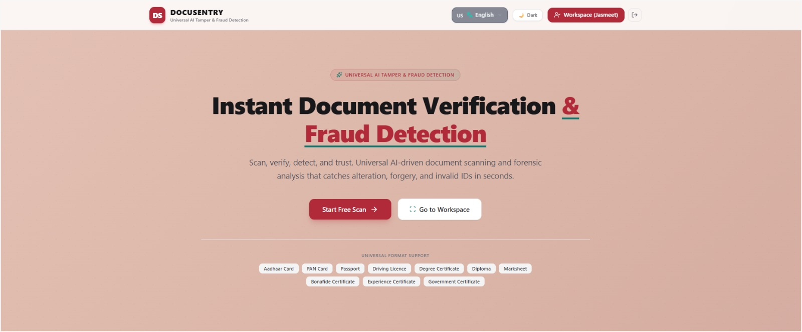

## Project Preview



## 📌 About the Project

AI Document Shield is a web-based project designed to analyze documents, identify potential signs of tampering, and assess identity-document risks. It helps users understand possible document inconsistencies through automated analysis.

## ✨ Key Features

- **Document Analysis:** Analyze uploaded documents.
- **Tampering Detection:** Identify potential signs of document manipulation.
- **OCR Processing:** Extract text from supported documents.
- **Risk Assessment:** Generate risk indicators to support document review.
- **Web Interface:** Interact with the analysis system through a user interface.

## 🛠️ Technologies Used

- React
- TypeScript
- Vite
- Node.js
- Express
- OCR and document-analysis tools

## 🚀 Getting Started

### Prerequisites

- Node.js and npm installed on your computer.

### Installation

1. Clone this repository:

   ```bash
   git clone https://github.com/Navdeep-Kaur-collab/ai-document-shield-portfolio.git
   ```

2. Open the project folder:

   ```bash
   cd ai-document-shield-portfolio
   ```

3. Install dependencies:

   ```bash
   npm install
   ```

4. Configure the required environment variables, if any, using the example environment file. Never commit real API keys or passwords.

### Run in Development Mode

Start the development server:

```bash
npm run dev
```

Open **http://localhost:3000** in your browser.

### Build for Production

Build the application:

```bash
npm run build
```

Start the built server:

```bash
npm start
```

Check the project configuration and required environment variables before deploying to a production environment.
## ⚠️ Disclaimer

This project provides document risk indicators and potential tampering analysis. Its results are not definitive proof that a document is genuine or fraudulent.

## 👥 Contributors

This is a collaborative project. Please acknowledge the team members who contributed to its design and development.

---

**Project:** AI Document Shield  
**Purpose:** Document analysis and risk assessment
